# 운전 첫걸음

처음 운전하는 사람을 위한 3D 애니메이션 강의. 장면마다 차 밖과 운전석을 직접 보면서 익힙니다.

## Chapter 1 · 주행 전 확인 사항

차에 타기 전 외부 점검부터 기둥 옆 출차, 운전석 기본 조작, 출발 직전 미러·시트 맞추기까지. 33장면.

| 차 밖 점검 | 기둥 옆 출차 | 사이드미러 맞추기 |
|---|---|---|
| 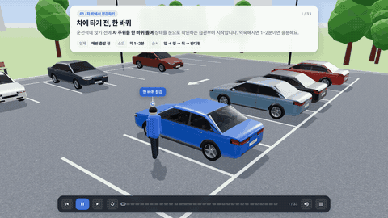 | 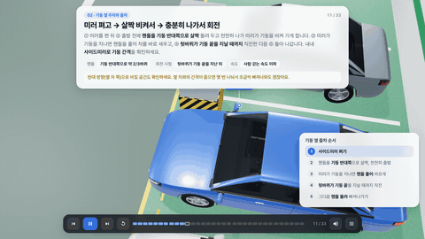 | 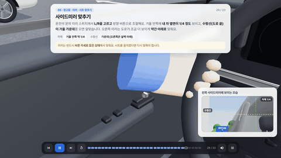 |

**목차**

1. **차 밖에서 점검하기** · 공원 주차장 차에 타기 전, 한 바퀴 · 차 밑과 주변 살피기 · 타이어 트레드(홈) 깊이 · 타이어 공기압 · 브레이크 패드·디스크 · 보닛 열고 오일·냉각수·워셔액 · 등화장치·와이퍼·유리
2. **기둥 옆 주차와 출차** · 아파트 지하 주차장 기둥 옆 칸은 기둥 쪽으로 붙여서 · 주차를 마치면 사이드미러 접기 · 미러를 펴고 그냥 나가면 ‘탁’ · 미러 펴고 → 살짝 비켜서 → 충분히 나가서 회전
3. **탑승 후 기본 조작** · 운전석 타면 가장 먼저, 안전벨트 · 페달은 오른발 하나로 · 시동 걸기 · 핸들 잡는 법·돌리는 법 · 방향지시등(깜빡이) · 비상등(비상 점멸등) · 와이퍼와 워셔액 · 전조등 켜기
4. **기어 · 파킹 브레이크 · 오토홀드** · 운전석 기어 ① 기어봉(레버식) · 기어 ② 칼럼식 · 기어 ③ 다이얼식 · 전자식 파킹 브레이크 (EPB) · D로 바꾸면 알아서 풀려요 · 사이드 브레이크가 손잡이식이라면 · 오토홀드 (AUTO HOLD) · 주차할 땐 오토홀드 끄기
5. **경고등 · 미러 · 시트 맞추기** · 운전석 계기판 경고등 확인 · 사이드미러 맞추기 · 룸미러 맞추기 · 핸들 위치 맞추기 (틸트·텔레스코픽) · 시트 포지션 맞추기 · 출발 준비 완료!

## Chapter 2 · 도로 주행 기본

주차장·건물에서 나와 도로에 들어서는 것부터 신호등, 좌회전·유턴, 교차로 우회전, 회전교차로까지. 14장면.

| 주차장에서 도로로 | 출구 앞 일단 정지 → 도로 진입 | 건물 출구 사각지대 |
|---|---|---|
| 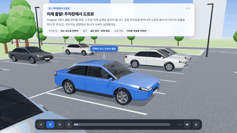 | 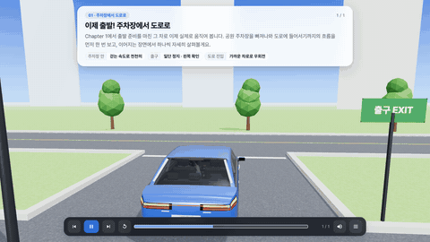 | 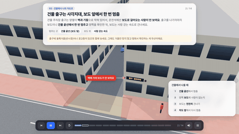 |
| **초록불은 직진 신호** | **빨간불 우회전** | **회전교차로 깜빡이** |
| 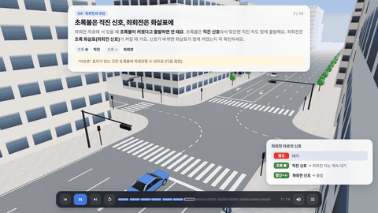 | 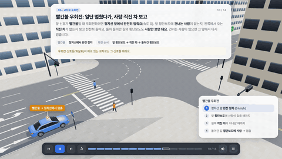 | 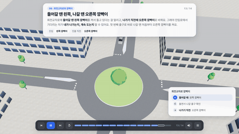 |

**목차**

1. **주차장에서 도로로** · 공원 주차장 → 앞 도로 이제 출발! 주차장에서 도로로
2. **건물·골목에서 나와 차도로** · 시내 · 건물 출구 · 골목 교차로 건물 출구는 사각지대, 보도 앞에서 한 번 멈춤 · 흐름을 탄 직진 차가 먼저 · 왼쪽이 비어도, 맞은편 유턴 차 먼저
3. **신호등과 정지선** · 시내 도로 · 교차로 빨간불이면 정지선 앞에서 멈춤 · 교차로가 아닌 곳의 정지선·신호등도 지키기
4. **좌회전과 유턴** · 시내 교차로 초록불은 직진 신호, 좌회전은 화살표에 · 비보호 좌회전: 초록불에, 맞은편 직진 차 먼저 · 유턴은 정지선에서 조금 떨어져서 기다리기
5. **교차로 우회전** · 시내 교차로 빨간불 우회전: 일단 멈췄다가, 사람·직진 차 보고 · 초록불 우회전: 속도 줄여 들어가고, 사람만 보기
6. **회전교차로와 깜빡이** · 회전교차로 · 교차로 회전교차로: 돌고 있는 차가 먼저 · 들어갈 땐 왼쪽, 나갈 땐 오른쪽 깜빡이 · 유도선 따라 도는 좌회전도 깜빡이는 꼭

## 맵

| 공원 주차장 + 앞 도로 | 아파트 지하 주차장 |
|---|---|
| 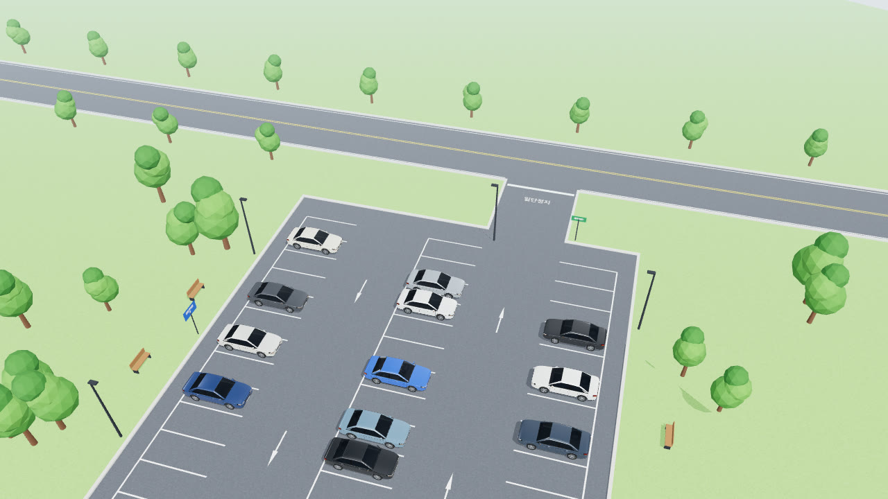 | 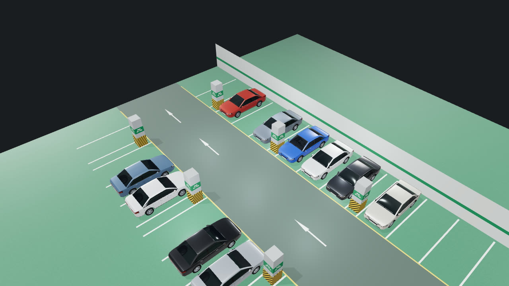 |
| Chapter 1 차 밖 점검 · 운전석 장면, Chapter 2 인트로 | Chapter 1 기둥 옆 주차와 출차 |
| **시내 도로 · 교차로** | **회전교차로** |
| 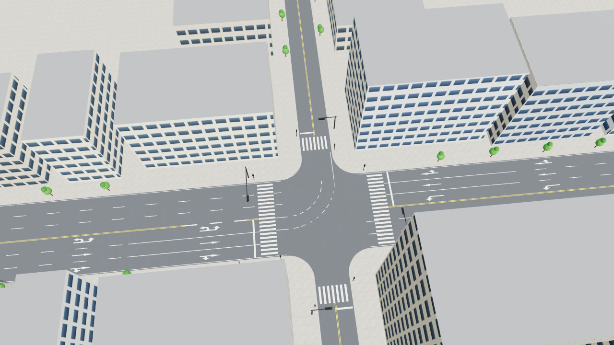 | 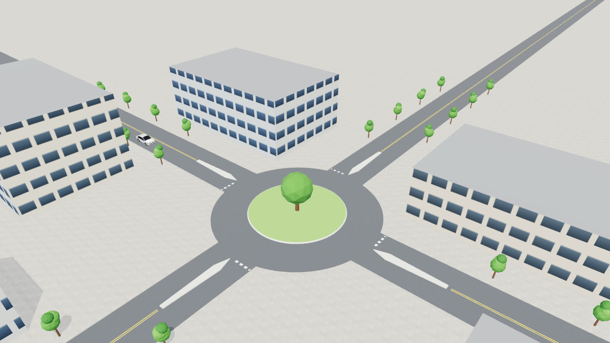 |
| Chapter 2 건물 출구 · 골목 교차로 · 신호등 · 좌회전·유턴 · 우회전 | Chapter 2 회전교차로 |
